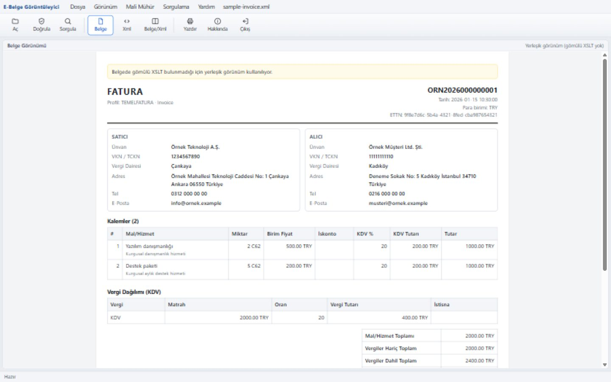

# e-Fatura Görüntüleyici

GİB'in Java Web Start tabanlı e-Fatura görüntüleyicisine alternatif, **Java gerektirmeyen**
açık kaynak masaüstü uygulaması. Arayüz HTML/JavaScript, arka uç Rust (Tauri 2); kullanıcı
tarafında Java, Node.js veya sunucu gerekmez.



## Özellikler

- **e-Fatura, e-Arşiv ve e-İrsaliye** XML belgelerini görüntüler (UBL-TR 1.2 / 2.1).
- Belge, XML içindeki **gömülü XSLT** ile GİB görüntüleyicisindeki gibi çizilir;
  gömülü XSLT yoksa yerleşik görünüm devreye girer.
- **Yazdır / PDF**: Windows yazdırma penceresi üzerinden kâğıda veya PDF'e aktarım.
- **Mali mühür / XAdES bilgileri**: imzalayan, sertifika sahibi, imza zamanı, algoritma,
  `DigestValue`. (Kriptografik doğrulama yapılmaz; bkz. [Sınırlamalar](#sınırlamalar).)
- **GİB'de Sorgula**: e-Fatura, e-Arşiv ve e-İrsaliye için ayrı sorgu mantığı. Belge
  kayıtlıysa fatura tarihi, imzalanma zamanı, GİB'e/alıcıya iletilme zamanları ve
  iptal/itiraz durumu gösterilir.
- XML dosyasını pencereye **sürükleyip bırakma**, **Dosya → Aç…**, komut satırı ve
  uygulama simgesi üzerine bırakma desteği.
- `index.html` tek başına tarayıcıda da çalışır (kurulumsuz deneme için).

> **Güvenlik notu:** Fatura XML'i üçüncü taraflardan gelir. Belge görünümü izole
> (sandbox) bir çerçevede gösterilir, XSLT çıktısındaki betikler/olay öznitelikleri
> temizlenir ve ağ erişimi CSP ile sınırlandırılır.

## Kurulum

Hazır kurulum paketi ve taşınabilir `.exe` dosyaları
[Releases](../../releases) sayfasından indirilebilir.

- **Kurulum paketi:** `e-Fatura Goruntuleyici_<sürüm>_x64-setup.exe`
  - Kullanıcı bazlı kurulum yapar (`%LOCALAPPDATA%`), yönetici yetkisi gerekmez.
  - Kaldırma: **Ayarlar → Uygulamalar → e-Fatura Goruntuleyici → Kaldır**.
- **Taşınabilir sürüm:** `efatura-goruntuleyici.exe` tek dosyadır; kurulum gerektirmez.

Windows 10 (1803+) ve Windows 11'de WebView2 çalışma zamanı genellikle hazır gelir;
yoksa [Microsoft WebView2 Runtime](https://developer.microsoft.com/microsoft-edge/webview2/)
kurulmalıdır.

Paket kod imzalı değildir; Windows SmartScreen "bilinmeyen yayıncı" uyarısı gösterebilir.
**Daha fazla bilgi → Yine de çalıştır** ile devam edebilirsiniz.

## Kullanım

1. **Dosya → Aç…** (`Ctrl+O`) ile bir `.xml` dosyası seçin, pencereye sürükleyin veya
   dosyayı uygulama simgesinin üzerine bırakın.
2. Görünüm: **Belge**, **Xml** veya **Belge/Xml** (yan yana; ara çubuk sürüklenebilir).
3. **Doğrula** ile mali mühür panelini açın; **Doğrulama Bilgileri** ve
   **Sertifika Bilgileri** ayrıntıları gösterir.
4. **Sorgula** ile belgeyi GİB sorgu servisinde kontrol edin.
5. **Yazdır** (`Ctrl+P`) ile yazdırın veya PDF olarak kaydedin.

Komut satırından:

```bat
efatura-goruntuleyici.exe "C:\yol\fatura.xml"
```

## Gizlilik

- Belgeler yalnızca cihazınızda işlenir; hiçbir sunucuya yüklenmez.
- Uygulama telemetri veya analitik göndermez.
- **GİB'de Sorgula** yalnızca belge kimlik bilgilerini (VKN/TCKN, fatura no, tutar, tarih)
  doğrudan `https://sorgu.efatura.gov.tr/` adresine gönderir. Sorgu yapılmadıkça ağ
  bağlantısı kurulmaz.

## Geliştirme

Gereksinimler:

- [Rust](https://rustup.rs/) (MSVC toolchain)
- Visual Studio Build Tools (C++ iş yükü) veya Visual Studio
- Node.js 18+

```bat
npm install
npm run dev        :: index.html'i kopyalar ve geliştirme modunu açar
npm run build      :: release exe + NSIS kurulum paketi
build.bat          :: MSVC ortamını yükleyip aynı derlemeyi yapar
npm run sync       :: index.html -> ui/index.html
```

`index.html` tek kaynak arayüz dosyasıdır. Tauri derlemesi öncesinde
`scripts/sync-ui.mjs` bu dosyayı `ui/index.html` olarak kopyalar; `ui/` altındaki kopyayı
elle düzenlemeyin. Geliştirme sırasında `index.html` değişikliklerini görmek için
`npm run sync` çalıştırıp pencereyi yenileyin (Tauri yalnızca `ui/` klasörünü izler).

### Proje yapısı

```
index.html              # tek kaynak arayüz (tarayıcıda da çalışır)
examples/               # örnek (tamamen kurgusal) fatura XML'i
scripts/sync-ui.mjs     # index.html -> ui/index.html
src-tauri/
  src/lib.rs            # gib_sorgula, dosya_oku, baslangic_dosyasi, cikis
  src/main.rs           # uygulama giriş noktası
  tauri.conf.json       # pencere, paketleme ve NSIS ayarları
  capabilities/         # Tauri izinleri
ui/                     # derleme sırasında üretilen kopya
```

`examples/sample-invoice.xml` tamamen kurgusaldır ve imza içermez; bu nedenle GİB
sorgusu için gereken `DigestValue` alanı örnek belgede yoktur.

### Tarayıcı sürümü

`index.html` dosyasını Chrome/Edge/Firefox'ta açabilirsiniz. Dosya seçme, görüntüleme,
Doğrula ve yazdırma çalışır. GİB sorgusu tarayıcıda CORS nedeniyle okunamaz; bu durumda
sorgu GİB'in kendi sayfasında açılır.

## Sınırlamalar

- Mali mühür / e-imza için **kriptografik doğrulama yapılmaz**; yalnızca belgedeki imza ve
  sertifika bilgileri gösterilir.
- GİB şema doğrulaması yapılmaz.
- Toplu klasör tarama yoktur (tek dosya).
- GİB sorgu servisi resmî bir API değildir; GİB tarafındaki değişikliklerden etkilenebilir.

## Katkı

Katkılar memnuniyetle karşılanır. Lütfen [CONTRIBUTING.md](CONTRIBUTING.md) dosyasını
okuyun. Hata bildirirken **gerçek fatura XML'i veya kişisel/ticari veri paylaşmayın**;
kurgusal örneklerle veya ekran görüntüsündeki hassas alanları kapatarak açıklayın.

## Lisans

[MIT](LICENSE) lisansı ile yayımlanmıştır. Ticari kullanım dahil serbestçe
kullanılabilir, değiştirilebilir ve dağıtılabilir; lisans metni korunmalıdır.

## Yasal not

Bu proje Gelir İdaresi Başkanlığı (GİB) ile bağlantılı değildir ve GİB tarafından
desteklenmemektedir. "e-Fatura", "e-Arşiv" ve "e-İrsaliye" ilgili kurumların
markaları olabilir. Uygulama "olduğu gibi" sunulur; vergisel veya hukuki bir garanti
vermez. Resmî doğrulama için GİB'in kendi sistemlerini kullanın.
